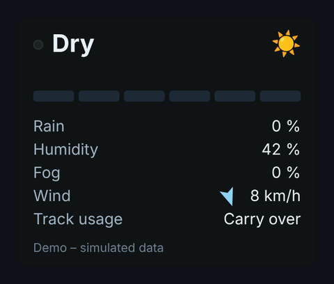

<h1>
  <picture>
    <source media="(prefers-color-scheme: dark)" srcset="assets/header-dark.svg?v=3">
    
  </picture>
</h1>

Small KAPPS add-on that shows live track stats in iRacing: wetness, rain, humidity, wind and track usage.

<p align="center">
  
</p>

## What it shows

| Stat | Details |
| --- | --- |
| **Track wetness** | Six-step bar from *Dry* to *Extremely wet*, with a *getting wetter* / *drying* trend |
| **Weather icon** | Top right: ☀️ 🌤️ ⛅ ☁️ by cloud cover, 🌧️ while it rains (5 % or more) |
| **Rain** | Current precipitation in % |
| **Humidity** | Relative humidity in % |
| **Wind** | Arrow plus speed in km/h. The arrow is relative to your car: up means tailwind, down means headwind |
| **Track usage** | Rubber state of the current session as reported by iRacing (for example *Low usage*, *High usage*) |

The overlay scales with its window, so resizing it in KAPPS never adds scroll bars. It uses the Roboto font.

## Install

1. Download this repository (**Code → Download ZIP**), unzip it and rename the folder to `TrackStats` (GitHub adds a `-main` suffix to the ZIP folder).
2. Put the folder into your custom apps folder, for example:
   ```
   %USERPROFILE%\Documents\iRacing\CustomApps\TrackStats
   ```
3. Start **KAPPS as administrator**. Open **App → Settings → Add App Folder** and select the `CustomApps` folder.
   If *Add App Folder* is missing, copy the `TrackStats` folder to
   `%AppData%\Kapps\iRacingBrowserApps\apps\` instead.
4. Open **Racing Overlay**, scroll to the bottom and click **Add Custom Overlay**.
5. Enter a name and this URL, then tick the options you need:
   ```
   http://127.0.0.1:8182/TrackStats/
   ```

The folder name in the URL must match the folder name on disk.

## Options

Add options to the end of the URL. Combine several with `&`.

| Option | Example | Effect |
| --- | --- | --- |
| `opacity` | `?opacity=70` | Background opacity, 0 to 100 (or 0 to 1). Default is solid |
| `color` | `?color=0f1314` | Background color as hex without `#`. Default `0f1314` |
| `flip` | `?flip=1` | Reverses the rotation of the wind arrow |
| `norden` | `?norden=1` | Wind arrow shows the wind direction relative to north (north is up) instead of relative to your car |
| `debug` | `?debug=1` | Shows the raw data KAPPS sends, useful when a value stays empty |

Example: `http://127.0.0.1:8182/TrackStats/?opacity=80&color=000000`

## Wetness levels

| Level | Label |
| --- | --- |
| 1 | Dry |
| 2 | Mostly dry |
| 3 | Very lightly wet |
| 4 | Lightly wet |
| 5 | Moderately wet |
| 6 | Very wet |
| 7 | Extremely wet |

## Demo

Download the repository and open `demo/index.html` in any browser (GitHub only shows its source). It runs on simulated weather and has sliders for wetness, sky and rain, so you can preview every state without iRacing.

## Good to know

- iRacing reports one wetness value for the whole track, not per section.
- Track usage is the text label iRacing provides. iRacing does not send a percentage.
- The overlay shows *Waiting for iRacing…* until data arrives. A single value shows `–` when iRacing is not sending it, for example outside a session.

## How it works

TrackStats is a plain `index.html` with no build step. Its only external request is the Roboto font from Google Fonts; without it the overlay falls back to Segoe UI or Arial. It reads the live iRacing data from the local KAPPS server over a WebSocket and renders it in the browser source.

---

Released under the [MIT License](LICENSE).

TrackStats is an unofficial fan project and is not affiliated with iRacing.com Motorsport Simulations or KAPPS.
